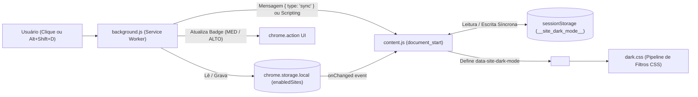

# Arquitetura e Especificação Técnica — Modo Noturno por Site

Este documento descreve a arquitetura interna, o fluxo de dados e as decisões técnicas da extensão **Modo Noturno por Site** (`v1.3.0`, Manifest V3).

---

## 1. Visão Geral da Arquitetura

A extensão é composta por três camadas desacopladas que se comunicam via eventos nativos da API de extensões do Chromium (`chrome.storage`, `chrome.tabs`, `chrome.runtime` e `chrome.scripting`):



---

## 2. Componentes do Sistema

### 2.1. `manifest.json` (Configuração Manifest V3)
- **Service Worker (`background.js`)**: Gerencia eventos de clique na barra de ferramentas, atalhos de teclado (`_execute_action` mapeado para `Alt+Shift+D`), mudanças de aba e sincronização entre janelas.
- **Content Scripts (`content.js` + `dark.css`)**: Configurados com `"run_at": "document_start"` e `"all_frames": false`. Isso garante que o CSS e o JS sejam injetados no documento principal antes da construção completa do DOM e da primeira pintura (*First Paint*).

### 2.2. `background.js` (Service Worker e Máquina de Estados)
Responsável pela lógica central de domínio e feedback visual na barra do navegador:

- **Normalização de Domínio (`siteKeyFromUrl`)**:
  - Extrai `hostname` e `protocol` usando `new URL(url)`.
  - Ignora esquemas restritos (`chrome://`, `edge://`, `about:`, `file://`), aceitando exclusivamente `http:` e `https:`.
  - Remove o prefixo `www.` (`hostname.replace(/^www\./i, '').toLowerCase()`), garantindo consistência entre subdomínios padrão.
- **Máquina de Estados de 3 Níveis (`toggleSite`)**:
  - Transição cíclica por domínio na chave `enabledSites` do `chrome.storage.local`:
    ```text
    null (Desativado) ──► 'medio' (Intermediário) ──► 'alto' (Noturno Total) ──► null (Removido do objeto)
    ```
  - Retrocompatibilidade (`normalizeMode`): Valores legados (`true` ou `'on'`) são automaticamente normalizados para `'alto'`.
- **Feedback Visual (`refreshAction`)**:
  - `medio`: Badge `MED` com fundo laranja (`#f57c00`) e texto branco (`#ffffff`).
  - `alto`: Badge `ALTO` com fundo verde (`#2e7d32`) e texto branco (`#ffffff`).
  - `null`: Badge vazio e tooltip contextualizado com o domínio atual.
- **Fallback de Injeção Dinâmica (`applyToTab`)**:
  - Tenta enviar `{ type: 'sync' }` via `chrome.tabs.sendMessage`.
  - Caso a aba tenha sido aberta antes da instalação/atualização da extensão (onde o content script ainda não existe), captura a exceção e injeta `dark.css` e `content.js` sob demanda via `chrome.scripting`.

### 2.3. `content.js` (Sincronização e Prevenção de FOUC)
O maior desafio de extensões de modo noturno em Manifest V3 é o fato de `chrome.storage.local.get()` ser **assíncrono**. Se o script aguardar a resolução da Promise no `document_start`, o navegador pode renderizar alguns quadros com fundo branco brilhante (*Flash of Unstyled Content* — FOUC).

Para eliminar esse efeito:
1. **Camada Síncrona Imediata (`sessionStorage`)**:
   - Na linha de execução principal de `content.js` (executada em `document_start`), a função `getCachedMode()` lê sincronamente `sessionStorage.getItem('__site_dark_mode__')`.
   - Se houver valor em cache na sessão da aba, `applyMode()` define imediatamente `document.documentElement.dataset.siteDarkMode` antes do primeiro *paint*.
2. **Camada Assíncrona Autoritativa (`chrome.storage.local`)**:
   - Em seguida, `sync()` consulta `chrome.storage.local.get('enabledSites')`, atualiza o cache do `sessionStorage` e reconcilia o atributo `data-site-dark-mode` no `<html>`.
3. **Tratamento de Contexto Invalidado**:
   - Silencia de forma segura erros do tipo `Extension context invalidated` que ocorrem normalmente em abas antigas quando a extensão é recarregada durante o desenvolvimento.

### 2.4. `dark.css` (Pipeline Óptico de Filtros CSS)
Em vez de percorrer o DOM alterando estilos inline (o que degrada a performance em SPAs pesados), a extensão utiliza seletores de atributo na raiz (`html[data-site-dark-mode]`) combinados com filtros acelerados por GPU:

| Regra / Alvo | Filtro Aplicado | Objetivo Técnico |
| :--- | :--- | :--- |
| `html[data-site-dark-mode="medio"]` | `invert(100%) hue-rotate(180deg) contrast(0.75)` | Inverte a luminância preservando a matiz das cores e reduz o contraste para criar um fundo cinza suave (`~#202020`). |
| `html[data-site-dark-mode="alto"]` | `invert(100%) hue-rotate(180deg)` | Inversão total de luminância com preservação de matiz, gerando fundo preto puro (`#000000`). |
| Mídias (`img`, `video`, `canvas`, `embed`, `object`, iframes de vídeo/mapas) | `invert(100%) hue-rotate(180deg)` | Segunda inversão que anula a inversão do elemento `<html>`, restaurando as cores reais de fotos, vídeos e mapas. |
| `background-image` inteligentes | `:not(:has(h1..h6, p, article, section, nav, form, table))` | Re-inverte avatares, ícones e thumbnails em `background-image` sem re-inverter containers estruturais de página inteira. |
| Nitidez no Modo Médio (`img`, `video`, `canvas`) | `invert(100%) hue-rotate(180deg) contrast(1.15)` | Compensa a redução de contraste (`0.75`) herdada do `<html>` no modo médio, devolvendo vivacidade às imagens. |
| Tela Cheia (`:fullscreen`, `:-webkit-full-screen`) | `filter: none !important` | Garante que vídeos ou apresentações em tela cheia não sofram dupla inversão. |
| Impressão (`@media print`) | `filter: none !important; color-scheme: light !important` | Impede que a impressão da página saia invertida ou com fundo escuro. |

---

## 3. Formato de Armazenamento (`chrome.storage.local`)

Os dados são armazenados sob uma única chave raiz `enabledSites`, mapeando cada domínio normalizado ao seu estado ativo:

```json
{
  "enabledSites": {
    "github.com": "medio",
    "wikipedia.org": "alto",
    "noticias.uol.com.br": "medio"
  }
}
```

> **Nota**: Domínios desativados têm sua chave removida (`delete sites[key]`), mantendo o armazenamento enxuto e livre de registros órfãos.
